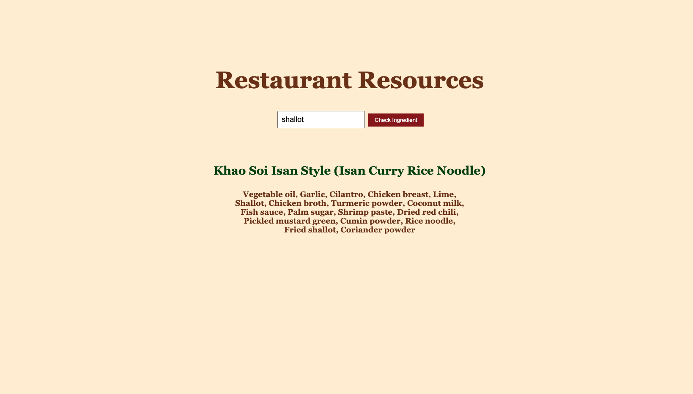

# 🍝Restaurant Resources

Front-end app for restaurant staff. Type in an ingredient and the app finds a recipe that uses it, then shows the dish name and its full ingredient list.

[Try out Restaurant Resource here!](https://restresources.netlify.app/)

## Preview



## Features

- Search for recipes by typing an ingredient
- Shows the name of a dish that uses that ingredient
- Lists every ingredient in the dish, which is helpful for planning a menu or checking what to have in stock

## Built With

- HTML, CSS and JavaScript
- Fetch API to request data from [Recipe API](https://recipeapi.io)

## How to Use

1. Clone repo
2. Get an API key from Recipe API
3. Create a file called `config.js` in the main folder and add your API key:

```javascript
const API_KEY = 'your-api-key-here';
```

The `config.js` file is listed in `.gitignore`, so your key stays out of the repo.

4. Open `index.html` in your browser
5. Type an ingredient and click **Check Ingredient**
